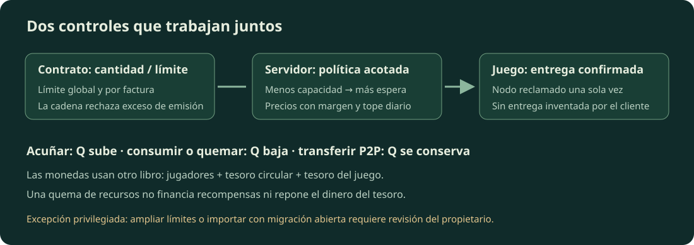
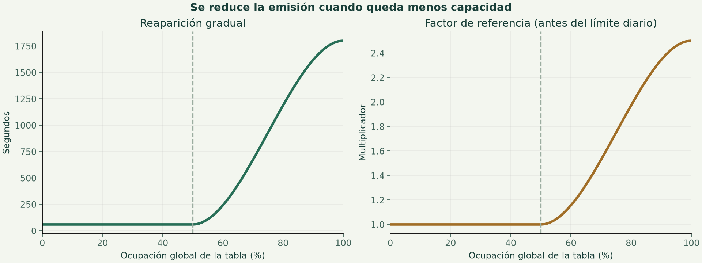
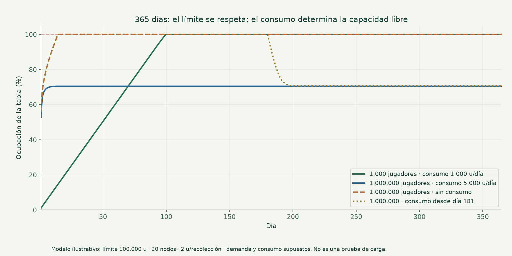

# Economía de Grassland Forest

Guía de operación · ampliación de recursos del 29 de octubre de 2026.

El código se modificó localmente, incluyendo `C:\Users\pc\Desktop\server2.js`. No se arrancó el backend con tus credenciales, no se desplegó y no se gastó dinero real para probarlo. La migración de reservas se ejecutará cuando arranque el backend actualizado y Mongo permita confirmar la transacción.

## Qué protege esta revisión

La economía tiene dos tesoros operativos: **circular**, que financia el bronce del botín, y **juego**, que recibe ingresos y contiene la reserva protegida. La antigua colección de reserva se conserva como archivo: su saldo y configuración se trasladan una vez al tesoro del juego, dentro de una transacción. No se borra la colección ni se restablecen los saldos de los jugadores.

El navegador dejó de tener autoridad para fijar oro, plata y bronce en `/api/stats/.../update`. Las monedas también se bloquearon entre las tablas que puede escribir el relay del cliente. La tienda del NPC ahora pide al servidor que calcule, cobre, entregue o retire el objeto y liquide la operación. Una respuesta ambigua queda registrada para conciliación; repetir su misma referencia no vuelve a ejecutar la entrega.

Los cambios manuales del mapa, imágenes y catálogo se conservaron. Los archivos editados tienen copias en `audits/economia-20261028/frontend`; el backend original está en `audits/economia-20261028/server2.before.js`. Para revertir algo, restaura el archivo concreto, sin hacer un restablecimiento general de Git.

## Las monedas y la contabilidad

Los tipos de cambio del juego permanecen fijos: **1 oro = 1.000 plata = 1.000.000 bronce**. Toda comparación económica se hace en bronce entero. Cambiar la denominación no crea riqueza: el cambio y las comisiones deben conservar el valor.

Se distinguen cuatro cantidades:

- **C:** monedas en las cuentas de los jugadores, expresadas en bronce.
- **A:** C más el tesoro circular y las monedas de botín reservadas. Es dinero que puede volver a los jugadores.
- **F:** saldo del tesoro del juego, incluyendo sus importes protegidos.
- **S:** A + F, oferta monetaria registrada.

El índice usa el crecimiento de A durante siete días. Es un **indicador monetario del juego**, no una medición completa de inflación de precios, ni una garantía de valor o de convertibilidad de un token. El cambio de población, las recompensas, las recargas y la redistribución desde tesoros también pueden moverlo. El historial de precios de objetos y el P2P ayudan a interpretar esos movimientos.

Destruir un objeto no destruye monedas. Por eso, la basura y los objetos caducados se muestran como una métrica aparte y ya no pueden reducir artificialmente la inflación monetaria. Las ventas P2P tampoco elevan por sí solas la valoración usada para cobrar servicios.

## Por qué los precios se comportan de forma más ordenada

El índice de tienda tiene como objetivo `1 + crecimiento monetario × sensibilidad`, con límites absolutos y un movimiento diario acotado. La sensibilidad predeterminada es 0,6 y el paso diario predeterminado es 3 %. El precio combina la base que tú configuras, el índice y la demanda de operaciones liquidadas por el servidor.

El cambio conjunto de índice y demanda se limita respecto al precio del día anterior. Recalcular varias veces no permite acumular sucesivos pasos diarios. Como las monedas son enteras, un precio pequeño puede permanecer igual durante varios días: redondearlo no debe convertir un límite del 3 % en un salto del 10 %.

El oro de recarga usa su precio base y sensibilidad propios; el paso predeterminado es 5 % por día. El precio del día se conserva al rehacer la fotografía horaria. Una cotización fija el importe durante quince minutos. Un pago tardío puede recibir la cantidad que corresponda al precio vigente, según las reglas del servidor.

Un precio de venta del NPC no puede superar su precio de compra. Cambiar una base manualmente es una decisión administrativa deliberada y puede producir un cambio mayor que el ajuste automático diario. Conviene probar el resultado antes de confirmar precios nuevos.

## Compras, ventas y comisiones

La tienda del NPC cobra el precio y una comisión del 5 % en las compras. En las ventas, descuenta el 5 % del importe bruto. Del importe bruto de la operación, 1,5 % alimenta el circular y 3,5 % corresponde al juego; los redondeos se hacen en bronce.

El precio pagado al NPC también entra en el tesoro del juego. Cuando el NPC compra un objeto, paga con ese tesoro, respetando su reserva y los importes retenidos. **Vender al NPC ya no crea monedas de la nada.** Si falta liquidez, el servidor rechaza la venta antes de consumir el objeto.

Ejemplo: una compra cuyo precio sea 10.000 BR cobra 10.500 BR. El circular recibe 150 BR y el juego 10.350 BR. Una venta cuyo precio bruto sea 10.000 BR entrega 9.500 BR al jugador, destina 150 BR al circular y reduce en 9.650 BR el saldo del juego. El valor total se conserva.

Los saldos que se muestran después de una operación proceden del servidor. Si ya se entregó el objeto y falla la actualización visual del inventario, se conserva el cobro y se avisa de que la sincronización está pendiente; no se concede un reembolso adicional por un simple fallo de lectura.

## Bronce al matar enemigos

En modo automático, un enemigo válido reserva una recompensa base de bronce cuando el circular puede pagarla. El mínimo predeterminado es 100 BR. La probabilidad adicional calcula un premio mayor, con los ajustes existentes de nivel, VIP y jefe; tras una racha se garantiza ese intento de bonificación.

Siguen siendo necesarios un nombre válido, el nivel de la zona, el tiempo de reaparición del enemigo y no haber alcanzado el límite diario. El límite predeterminado es 25 recompensas por jugador al día. La configuración manual del tesoro puede cambiar esas condiciones o pausar los incentivos.

El bronce sale del circular, queda reservado mientras está en el suelo y se suma a la cuenta al recogerlo. **Si nadie lo recoge en cinco minutos, vuelve al circular.** Caducar el botín no debe agotar la reserva mediante una quema involuntaria. Si no hay fondos, no se inventan monedas para ocultar el problema.

## Crafteo, horno y devoluciones

El crafteo cobra, por defecto, 4 % del valor de referencia del resultado, con un mínimo de 50 BR por unidad que sigue el índice. Fundir usa, por defecto, 5 % y el mismo mínimo. El servidor calcula el importe y, si hace falta, cambia plata u oro y devuelve el cambio exacto. Una caída del servicio o una ruta antigua que devuelva 404 ya no permite continuar gratis.

Cada cobro tiene una referencia y retiene su importe en el tesoro del juego hasta recibir confirmación. Un crafteo o fundido confirmado libera la retención. Un informe de fallo del navegador solicita revisión: **no autoriza por sí mismo a devolver dinero**. Esto impide craftear, reclamar falsamente un fallo y conservar el objeto junto con el reembolso.

En Economía → Supervisor aparecen los recibos pendientes. Verifica cadena e inventario antes de marcar una entrega o devolver un servicio. En una operación de tienda, indica cuántas unidades se confirmaron realmente: el servidor calcula el pago o la devolución y libera la retención correspondiente. Los casos ambiguos de consumo de materiales también requieren revisar qué transacciones se confirmaron; no repitas operaciones a ciegas.

## El supervisor automático

Se añadió un supervisor por reglas, sin proveedor externo de IA, claves de un modelo ni decisiones financieras generadas por texto. Sus decisiones se pueden explicar y comprobar. Se ejecuta cada minuto, evita solaparse y consulta lotes acotados.

- Revisa hasta veinte recargas pendientes por ejecución. Para acreditar exige un pago válido y tres confirmaciones; el recibo y las monedas se confirman juntos en Mongo. No usa dos veces el mismo hash.
- Repone el circular desde excedentes del juego, con objetivo de 1.000.000 BR. La referencia diaria impide repetir esa transferencia automáticamente durante el mismo día UTC.
- Conserva un piso de 5.000.000 BR en el juego, más los importes retenidos para operaciones. El piso circular para quemas es 100.000 BR. Los fondos de botín reservados están separados del saldo disponible.
- La quema automática solo considera excedentes circulares por encima del objetivo, con ocho fotografías diarias que cubran siete días y crecimiento monetario superior al 20 %. Su máximo es 0,1 % del saldo circular por día UTC.

Puedes pausar el supervisor o únicamente su quema desde el panel. La recuperación de pagos ya enviados sigue activa aunque pauses la política de tesorería. El supervisor no firma pagos con la cartera del jugador, no gasta zkLTC de la reserva y no necesita conocer su contraseña.

Los pisos elegidos son parámetros conservadores de esta revisión, no una demostración de solvencia para cualquier número de jugadores. Hay que comparar ingresos, pagos, población activa y liquidez conforme crezca el juego.

## Qué ocurre al quemar

Una quema reduce el saldo del tesoro elegido y registra su valor equivalente en bronce. Una quema del circular reduce A y S. Una quema del juego reduce S, pero no retira monedas de las cuentas de los jugadores ni reduce directamente A. Por eso, quemar el tesoro del juego no corrige automáticamente un exceso de dinero activo.

Las quemas de tesorería son movimientos del **libro económico interno**. No son una transacción `burn()` de un ERC-20 ni destruyen zkLTC. Si necesitas quemar un token emitido por otro contrato, hace falta una integración específica y verificable con ese contrato.

No quemes para conseguir un precio concreto ni uses la reserva para sostener una cotización prometida. Los límites de variación evitan saltos automáticos, pero no garantizan demanda, rentabilidad o estabilidad de una moneda externa. Una quema no es una solución universal a la inflación.

## Cómo mantenerla operativa

Primero comprueba el capital de trabajo: sin excedentes del juego, el NPC no puede comprar objetos; sin saldo circular, no puede haber recompensas financiadas. Un ajuste administrativo de saldo es una decisión de emisión o contabilidad: no equivale a ingresar dinero real desde una cartera.

Las cuentas nuevas empiezan sin los antiguos regalos automáticos de 1.000 oro, plata y bronce. Esto limita la emisión por creación de carteras; los saldos existentes permanecen intactos. Revisa la progresión inicial y proporciona recompensas o equipo de inicio mediante un presupuesto explícito, sin volver a introducir saldos ilimitados por registro.

Evita aumentar simultáneamente premios de misiones, regalos, rentabilidad de cultivos y descuentos. Conserva presupuestos de monedas y los límites globales de recursos, vigila la relación entre jugadores activos y recompensas y revisa precios P2P con volumen suficiente. No uses operaciones entre cuentas propias para justificar cambios de precio.

Revisa los recibos pendientes, el estado del supervisor, los errores RPC, el espacio disponible de Mongo y las tendencias de varios días. Una falta puntual de datos debe verse como falta de datos, no como inflación cero. Los gráficos ahora distinguen esos casos, muestran un punto único y liberan sus observadores al cerrar el panel.

## Puesta en marcha y límites comprobados

Publica juntos el backend y los archivos web de esta revisión, y reinicia el proceso correspondiente. Los cambios en el disco no actualizan un servidor que ya está ejecutando código antiguo. Las versiones de caché de los archivos web se actualizaron para evitar mezclar ambos flujos.

Mongo debe admitir transacciones: una instalación standalone no las soporta. Usa una configuración compatible y comprueba sus permisos e índices antes de abrir los cobros. La política es detener una operación que no pueda confirmarse de forma segura. Referencia: [transacciones de MongoDB](https://www.mongodb.com/docs/manual/core/transactions/) y [consideraciones de producción](https://www.mongodb.com/docs/manual/core/transactions-production-consideration/).

Mantén una sola instancia activa del backend del juego mientras el botín y otros estados de sesión sigan usando memoria de proceso. Esta revisión no convierte todo el juego en un servicio distribuido.

La regresión local comprobó cobros, pagos duplicados, fallos de escritura, conservación de valor, migración, liquidez, gráficos y ciclos de apertura/cierre con datos simulados. No sustituye una prueba integrada con tu Mongo, tus contratos, tus permisos y el RPC real. Mongo y una blockchain no comparten una única transacción: un resultado ambiguo necesita conciliación.

También hay rutas generales de relay y actividades fuera del flujo económico revisado. Sus permisos, los contratos y la emisión de recursos deben auditarse antes de atribuir seguridad total al proyecto o usar fondos de valor real. La ampliación activa `GATHER_ENFORCE` y `GameScene.GATHER_SERVER`: el servidor valida los nodos y la herramienta, decide los premios y confirma sus facturas. Esto exige desplegar ambas partes juntas. No se modificaron tus credenciales.

No sería honesto prometer cero bugs, cero fugas o estabilidad absoluta. Lo comprobable aquí son las reglas implementadas, la conservación de saldos en los casos ensayados y los informes de `audits/economia-20261028/`. Puedes operar con límites y diagnósticos claros, manteniendo la revisión de las excepciones.

## Recursos: tablas globales, facturas y capacidad libre

Se leyó el contrato que entregaste como `C:/Users/pc/Desktop/rr.txt.txt`; su código no se modificó. `getTipoStats` informa cantidad global activa, límite global, máximo por factura, facturas activas y unidades quemadas. Las cantidades grandes se calculan con enteros exactos, sin redondearlas con `Number`.

**Ocupación = cantidad global / límite global. Capacidad libre = máximo entre cero y límite − cantidad.** El límite por factura controla cada pila; no es un límite de cantidad de facturas. Dividir un recurso en más facturas no evita el límite global. Por ejemplo, 90.000 unidades de madera con un límite de 100.000 ocupan 90 %, aunque cada factura admita solamente 50 unidades.

Las ocho tablas reguladas son madera de pino, madera seca, madera con hojas, piedra, mineral de cobre, mineral de hierro, carbón y mineral de carbón. Se conservan las probabilidades y salidas mixtas de tus árboles y minas. Si un nodo entrega varios recursos, usa la espera más alta de sus tablas; excluye las salidas llenas y se bloquea si todas están llenas. La capacidad por recurso y por factura limita lo que puede entregarse.

**No se amplían tablas automáticamente.** Se eliminó el antiguo crecimiento automático de límites al agotarse el cupo. En Centro de control → Recursos puedes ver ocupación, capacidad libre, máximos por factura, consumo acumulado, reaparición y factor de referencia. Puedes simular y guardar la curva; dos administradores no pueden sobrescribir silenciosamente la misma versión.

No se añadió una cuota económica diaria de tala o minería por jugador. El freno económico de esos recursos viene de sus tablas. Los límites de solicitudes y concurrencia protegen el servicio frente a saturación: no crean más recursos ni son un presupuesto económico oculto. Los límites existentes de herramientas especiales de tienda, recargas y recompensas monetarias se conservan: corresponden a otros flujos.

## Cómo cambia la reaparición y el precio

La regulación predeterminada empieza al 50 %. Se calcula `t = acotar((ocupación − 50) / 50, 0, 1)` y `curva = t² × (3 − 2t)`. La espera es `60 + 1.740 × curva` segundos; el factor de referencia es `1 + 1,5 × curva`. Puedes ajustar estos parámetros dentro de rangos explícitos desde el panel.

| Ocupación | Reaparición aproximada | Factor de referencia |
| --- | --- | --- |
| 0–50 % | 60 s | ×1,00 |
| 75 % | 930 s (15,5 min) | ×1,75 |
| 90 % | 1.619 s (27 min) | ×2,344 |
| 100 % | 1.800 s; no se acuña sin capacidad | ×2,50 |

La curva es gradual y tiene máximos; evita saltos y tiempos ilimitados. La ocupación mide **escasez de capacidad para emitir**, no demuestra que un objeto sea escaso en manos de jugadores ni que exista demanda de compra. Una tabla muy llena puede contener mucho stock inactivo. Por eso el factor modifica la referencia del NPC, conserva el margen compra/venta, respeta el límite diario de variación y deja intactos los precios manuales que no siguen el índice. Un ×2,5 de referencia no implica subir el precio final 150 % en un día. Las ofertas P2P conservan el precio elegido por su vendedor.

Los datos del contrato se comparten durante 15 segundos, con un máximo de tres lecturas simultáneas de tablas por instancia; el aviso de migración se consulta cada minuto. Un RPC fallido se muestra como lectura no disponible y no se convierte en cantidad cero. El contrato decide el cupo final al confirmar la acuñación, incluso si otra petición usó parte del cupo desde la fotografía anterior. Una compra NPC de recursos comprueba la capacidad conocida antes de cobrar; un cambio posterior o una confirmación ambigua requiere conciliación.

La reclamación del nodo usa una escritura condicional atómica en Mongo: dos jugadores no obtienen simultáneamente el mismo nodo. La herramienta debe existir en la cartera y corresponder a la actividad. El recibo guarda la referencia de la acción; al repetirla se devuelve el mismo resultado, sin volver a emitir. Se conservan siete días de recibos de recolección. Solo se muestran como entregados los objetos con confirmación; un inventario lleno no elimina la factura que ya existe en la cadena. Este control no sustituye un sistema completo contra bots o trampas de movimiento.

## Transferencias P2P que conservan recursos

El mercado ahora usa `transferInvoice`: al publicar, el recurso pasa del vendedor a custodia del relayer; al comprar, de custodia al comprador; al cancelar, se devuelve el sobrante. Estas transferencias conservan la cantidad global y no se contabilizan como quemas. Por eso se puede vender una madera existente aunque su tabla esté llena. La custodia del mercado es una tenencia temporal de **objetos**, no un tercer tesoro de monedas.

El cobro y el derecho de entrega se guardan juntos en una transacción Mongo. Cada compra tiene una referencia y un recibo distinto. Si se pierde una respuesta, la misma referencia recupera el resultado. Antes de emitir una transferencia se guarda su transacción firmada: la recuperación vuelve a emitir los mismos bytes y verifica su hash, destino y contenido. No se vuelve a cobrar por pulsar comprobar entrega. La página muestra las entregas pendientes y permite continuar un depósito que aún no terminó.

Mongo y la cadena tienen confirmaciones independientes. Si no existe un hash verificable, el sistema exige revisión; no supone que el envío falló ni fabrica otro. Una interrupción entre asignar un nonce y guardar el envío puede necesitar reparar la cola del relayer después de verificar sus transacciones pendientes. No cambies el nonce ni envíes una compensación a ciegas. El supervisor procesa lotes limitados y evita solapar sus barridos.

**Publicaciones anteriores:** las que no tienen prueba del nuevo depósito quedan en `legacy_review`. Se conserva su historial, pero se impiden compras nuevas sobre una custodia no demostrada. Recursos → Entregas por conciliar muestra recibos y una muestra de hasta veinte publicaciones antiguas. Antes de compensar una antigua publicación, verifica factura original, quema antigua, cobros, entregas y propietario. No hay una conversión automática que invente esas pruebas. Conserva la copia de Mongo antes de conciliar; no borres los registros antiguos.

## Qué ocurre cuando consumes o quemas recursos

La conservación es `cantidad final = cantidad inicial + acuñación − consumo o quema`. Transferir y dividir facturas mantiene la cantidad global. Consumir recursos mediante una transacción confirmada libera capacidad en su tabla y permite nuevas entregas. El crafteo sigue cobrando monedas mediante sus recibos; destruir materiales y cobrar el servicio son operaciones diferentes.

Una tabla llena no vuelve a tener espacio simplemente esperando treinta minutos. Necesita consumo real, una quema válida o una ampliación administrativa deliberada. Quemar material útil solo para acelerar el respawn reduce las existencias del jugador y puede empeorar su experiencia; favorece recetas y usos que tengan valor jugable. Mantén una relación razonable entre recursos generados y recursos utilizados. No elimines materiales de otros jugadores sin una regla del juego que lo autorice.

Las quemas de recursos no alimentan el circular ni la reserva del juego. Las quemas monetarias siguen los pisos y retenciones descritos arriba. Ni una quema ni una subida de precio garantizan demanda, rentabilidad, convertibilidad o valor de un token externo.

## Excepciones del propietario del contrato

En el contrato entregado, **la importación de migración abierta puede superar los límites global y por factura**. La prueba con su código original importó once unidades en una tabla limitada a diez; el resultado se documenta, no se oculta. El panel consulta `migrationSealed` y distingue sellada, abierta y no verificable.

`sealMigration()` es irreversible. No se ejecutó ni se añadió un botón que la active automáticamente: primero verifica que toda tu migración esté terminada. El propietario también puede modificar `setLimit`, por lo que la estabilidad depende de no ampliar límites sin revisar existencias, consumo y población. El editor del panel permite ampliaciones explícitas firmadas con tu cartera y registra su hash; no baja límites ni firma por ti. Subir el límite reduce inmediatamente la ocupación relativa y admite más emisión. No se necesita redeplegar el contrato para usar esta política del servidor.

## Simulación de miles y millones de jugadores

El ensayo usa una tabla hipotética de 100.000 unidades, veinte nodos, dos unidades por recolección y 365 días; parte de cero. La demanda y el consumo son supuestos explícitos, no mediciones de tus jugadores. Los cuatro escenarios conservan cada unidad y nunca exceden el límite. Con un millón de jugadores y cero consumo se alcanza 100 % y se detiene la emisión. Con consumo de 5.000 unidades diarias, termina cerca del 70,5 %. Al activar consumo desde el día 181, vuelve a recuperar capacidad. Incluso 1.000 jugadores pueden llenar la tabla si la producción supera su consumo.

Se procesaron además **1.000.000 consultas de política en lotes de 1.000**: compartieron ocho lecturas y un máximo de tres lecturas activas, con ocho entradas finales de caché y ninguna petición en cola. Esto demuestra que la política no necesita una entrada por jugador. **No demuestra que Railway, el RPC, Mongo o el relayer atiendan a un millón de jugadores simultáneos.** Las escrituras, el gas, la latencia, el tamaño de los inventarios y las consultas agregadas del mercado requieren una prueba de capacidad con infraestructura y datos reales antes de crecer. La presencia actual se etiqueta por instancia; no se presenta como un contador distribuido.

Los informes reproducibles están en `audits/recursos-20261028/simulation.json`, `chain-integration.json`, `unit-results.txt` y `browser-results.json`. La prueba integrada ejecutó el contrato original en una EVM local y Mongo en un replica set temporal. Verificó una reclamación ganadora entre cien concurrentes, rechazo de emisión por exceso, custodia, comprador autorizado, cantidades manipuladas, dos compras iguales con recibos diferentes, repetición de respuestas y conservación de objetos y monedas. No usó carteras, claves ni saldos de producción.

## Monitor de errores, conectados y cuentas

El monitor agrupa fallos repetidos, los ordena por ocurrencias y fecha y presenta un resumen corto. Al abrirlo se puede ver y copiar mensaje, traza y hasta veinte carteras afectadas por grupo, con su contador. La búsqueda de errores de cliente acepta una cartera completa; consulta hasta mil identificadores de error asociados. Las atribuciones antiguas sin sesión verificada se señalan como históricas. El botón de limpiar relayer archiva la bandeja hasta el momento elegido: conserva transacciones, pagos y evidencia para conciliación.

«Conectados ahora» cuenta carteras autenticadas con sockets activos en **esta instancia**. Dos pestañas de una misma cartera cuentan una vez; al desconectarse el último socket se retira. Un registro persistido en Mongo ya no se presenta como alguien conectado. Si la consulta falla se muestra un dato no disponible. Si se escala a varios procesos, hay que agregar presencia con un servicio compartido antes de llamar global a ese contador.

El directorio Cuentas exige administrador en el servidor y pagina cincuenta filas. Muestra cartera, nombre, correo realmente registrado, proveedor, verificación, nivel, mundo y actividad disponible. Los accesos sociales nuevos de Google/Apple guardan el correo cuando el proveedor confirma su verificación; una dirección de cartera no permite adivinar un correo. Los registros anteriores sin ese dato siguen sin correo hasta un acceso válido que permita actualizarlo. No se seleccionan claves privadas, fragmentos del vault, contraseñas ni datos de recuperación. La pantalla limpia sus filas al invalidarse la sesión; no exporta masivamente correos.

## Publicar esta ampliación sin perder tu trabajo

Los cambios están en disco; **esta revisión no se desplegó en Railway** y no modificó saldos de producción. Las capturas que compartiste muestran Mongo HA; conserva esa configuración y verifica que el backend apunte al replica set. No vuelvas a standalone para sortear un fallo de cobro: las operaciones financieras necesitan transacciones. La configuración HA se describe en la [documentación de Railway](https://docs.railway.com/databases/mongo-ha).

1. Conserva una copia de la base y de los archivos. Las copias del inicio de esta ampliación están en `audits/recursos-20261028/before/`; no uses un reset global de Git sobre tu trabajo manual.
2. Actualiza juntos `C:/Users/pc/Desktop/server2.js`, `C:/Users/pc/Desktop/marketplace-routes.js` y `C:/Users/pc/Desktop/gf-wallet-sdk/server/gf-wallet-routes.js` en el repositorio que Railway despliega. Esta última ruta guarda el correo social verificado; no es el archivo de SDK del navegador.
3. Publica los archivos web indicados en `audits/recursos-20261028/manifest.json`, incluyendo `recursos.html/js`, `cuentas.html/js`, `operations-panels.css/js`, el mercado, su ilustración y las imágenes de la guía. Los HTML apuntan a las nuevas versiones de los scripts cambiados.
4. Reinicia el backend actualizado y entra en Centro de control → Recursos. Comprueba las ocho tablas y el aviso de migración. Una tabla ausente requiere configuración del propietario; no se da de alta con cantidades inventadas.
5. Haz una compra pequeña, una venta, un crafteo y una tala/mina con una cuenta de prueba. Comprueba recibo, saldo y factura. En P2P, prueba depósito, compra parcial y cancelación del sobrante. Revisa pendientes antes de repetir una operación.
6. Revisa tus publicaciones anteriores y la progresión con inventarios pequeños. Conserva una instancia del juego hasta resolver los demás estados de sesión que aún dependen de memoria de proceso. Mongo HA no convierte por sí solo todo el juego en un servicio distribuido.

No hace falta vigilar manualmente cada precio o cada quema: hay reglas acotadas, referencias y trazabilidad para los flujos revisados. Sí hace falta revisar excepciones, liquidez, capacidad ocupada, consumo y fallos persistentes. El límite impide emisión ilimitada bajo sus condiciones; la utilidad del juego y una operación mantenida determinan que la economía siga funcionando a largo plazo.
